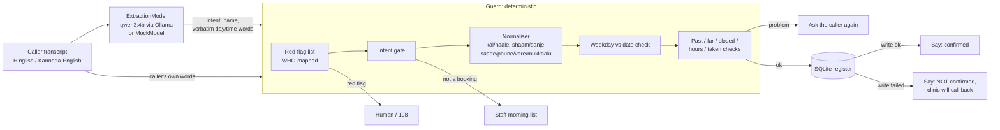

# Indic booking guard

A deterministic guardrail and eval layer that sits between an LLM's extraction and a clinic booking write, for callers who speak Hinglish or Kannada-English (Latin script).

It resolves relative dates, day-parts and half-hours in code ("kal shaam saade chaar baje", "naale sanje naalku-vare"), checks a stated weekday against the date, validates the slot against the register, sends cardiac and stroke red-flag phrases to a human, and never says "confirmed" unless the register write succeeded. A real local model (Ollama `qwen3:4b`) is in the loop. A golden set measures raw model vs the community dateparser fix vs model + guard.

Built in one night (Oct 7 to 8 2026) on top of the `clinic-overflow-desk` front-end prototype (copied unchanged into `prototype/`).

<!-- RESULTS_SUMMARY -->

## Discovery brief

**Customer.** The ops or FDE lead at an Indian clinic-booking voice agent vendor, or a single clinic running one, whose callers mix Hindi or Kannada with English.

**Broken workflow.** The caller says a day and a time in their own words. The model turns them into a date and a time. A tool writes the booking. The agent tells the caller it is confirmed. Three things go wrong:
1. **Dates and times.** Production booking agents get them wrong today, on frontier models. A live gpt-realtime reservation agent "usually resolves the date one day late", and gpt-realtime-1.5 said "Ok, on Friday, 9th May" for a Saturday and kept insisting after the caller corrected it ([OpenAI community, 2026-02-14, updated 2026-04-07](https://community.openai.com/t/bug-gpt-realtime-usually-miscomputes-next-weekday-by-1-day-appears-to-use-2025-calendar/1374221)). An AI-receptionist builder writes "We all know llms are super bad at dates and time", and the suggested fix is to resolve them in Python with dateparser ([LiveKit community, 2026-07-24](https://community.livekit.io/t/agent-hallucination-data-and-time/1723)).
2. **That fix does not cover Indic speech.** dateparser 1.4.3 returns `None` for "kal shaam saade chaar baje", "parso subah 10 baje" and "naale sanje naalku gante" (local test, `../decisions/local-model-probe.md`).
3. **Emergencies and failed writes.** A booking agent must not book a caller who reports chest pain, and must not say "confirmed" when the write failed.

**Constraints.** Latency: the guard adds well under a millisecond per call (pure Python), so the model call dominates. Cost: no paid API; one local 4B model. Compliance: minimum data (name, slot); no medical advice; red flags go to a human or 108. Language: Hinglish and Kannada-English in Latin script; Devanagari is out of scope for dates (red flags in Devanagari are covered).

**Honest limits of the evidence.** No public report was found of a deployed Hindi, Hinglish or Kannada booking agent writing a wrong date. The Indic-specific pain is a reasoned inference from the cited English failures plus the local dateparser and qwen3:4b tests, not an observed incident.

## Architecture



Probabilistic part: the model call (`guard/model.py`). It supplies intent, the patient's name (kept only if those words appear in the transcript) and, for English only, verbatim words as a dateparser fallback. **The model's own date and time are never used for the booking.**

Deterministic part: everything in `guard/normalise.py`, `guard/redflags.py`, `guard/guard.py`, `guard/register.py`.

Human in the loop: red flags (human or 108), non-booking requests (staff list), every ambiguity (ask the caller again), and every failed write (the clinic calls back).

## Files

| Path | What |
|---|---|
| `data/TAXONOMY.md` | Error taxonomy and label spec, written before any case or code |
| `data/golden.jsonl` | Main golden set |
| `data/held_out.jsonl` | Held-out slice, written by a separate agent from the taxonomy only, committed (sha256 in `../STATE.md`) before the normaliser existed |
| `data/check_labels.py` | Label consistency checker (calendar, sessions, register) |
| `data/clinic.json` | Synthetic clinic: hours, closed day, seeded register |
| `guard/` | schema, model interface, normaliser, red flags, guard, baselines, register |
| `eval/run.py` | Eval: writes `eval/RESULTS.md` and per-case `eval/RESULTS_cases.jsonl` |
| `eval/collect.py` | Calls the real model once per case, caches to `eval/cache/*.jsonl` (committed) |
| `eval/confirmation.py` | Ungated confirmation baseline on write failures, writes `eval/CONFIRMATION.md` |
| `tests/` | pytest, mock model only |
| `prototype/` | The Oct 1 front-end demo, unchanged |

## How to run

```bash
cd build
pip install fastapi pydantic httpx dateparser pytest     # Python 3.13 used
python -I -m pytest -q tests                              # mock model only, no Ollama needed
python -I eval/run.py --offline                           # regenerate RESULTS.md from the committed model cache
python -I eval/run.py --model mock                        # deterministic layer alone (MOCK model)

# with a real local model
ollama pull qwen3:4b
python -I eval/collect.py qwen3:4b                        # fills eval/cache/qwen3_4b.jsonl (~10 s per case)
python -I eval/run.py
python -I eval/confirmation.py
```

`python -I` keeps stray files in the working folder from shadowing the standard library. No API key is needed (`.env.example`).

<!-- EVAL_RESULTS -->

<!-- FAILURE_ANALYSIS -->

## What is mocked, synthetic or missing

- **All cases are synthetic, AI-written, not native-speaker-audited.** The Hindi and Kannada phrasing and labels need a native speaker's audit (weekend 1, task 1).
- **The red-flag list is the author's translation of the WHO signs, not clinically validated.** Cardiac and stroke signs only.
- **Text only.** No audio, ASR, barge-in or latency of a real call. "ASR noise" cases are typed imitations.
- **The register is a local SQLite table**; tool failures are simulated (`Register(fail_writes=True)`).
- `MockModel` is used only in pytest and `--model mock`; it is labelled `MOCK` everywhere it appears.
- One local 4B model. Every lift is "vs qwen3:4b (4B, Q4)", not a claim about production models.

<!-- ROADMAP -->
