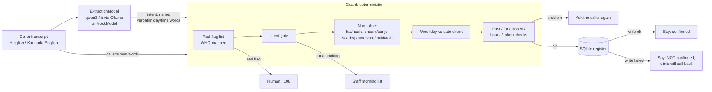

# Indic booking guard

A deterministic guardrail and eval layer that sits between an LLM's extraction and a clinic booking write, for callers who speak Hinglish or Kannada-English (Latin script).

It resolves relative dates, day-parts and half-hours in code ("kal shaam saade chaar baje", "naale sanje naalku-vare"), checks a stated weekday against the date, validates the slot against the register, sends cardiac and stroke red-flag phrases to a human, and never says "confirmed" unless the register write succeeded. A real local model (Ollama `qwen3:4b`) is in the loop. A golden set measures raw model vs the community dateparser fix vs model + guard.

Built in one night (Oct 7 to 8 2026) on top of the `clinic-overflow-desk` front-end prototype (copied unchanged into `prototype/`).

**Results in one paragraph** (96 synthetic cases, every number vs qwen3:4b (4B, Q4), details in `eval/RESULTS.md`). The model alone wrote or attempted a wrong booking on 22 of 96 cases. The community fix (dateparser on the model's words) avoided most wrong writes (2 of 96), but only because it could resolve almost nothing, so it blocked 40 of 45 bookings it should have made. Model + guard: 0 wrong writes on the 72-case main set and 1 wrong write on the 24-case blind held-out slice before that bug was fixed (23/24 correct), red-flag recall 11/11. **Caveat first:** both sets were written by AI agents from the same label spec the normaliser implements, so these numbers mostly show that the code follows its own spec. They are not a measure of real-caller robustness. See [Failure analysis](#failure-analysis).

## Discovery brief

**Customer.** The ops or FDE lead at an Indian clinic-booking voice agent vendor, or a single clinic running one, whose callers mix Hindi or Kannada with English.

**Broken workflow.** The caller says a day and a time in their own words. The model turns them into a date and a time. A tool writes the booking. The agent tells the caller it is confirmed. Three things go wrong:
1. **Dates and times.** Production booking agents get them wrong today, on frontier models. A live gpt-realtime reservation agent "usually resolves the date one day late", and gpt-realtime-1.5 said "Ok, on Friday, 9th May" for a Saturday and kept insisting after the caller corrected it ([OpenAI community, 2026-02-14, updated 2026-04-07](https://community.openai.com/t/bug-gpt-realtime-usually-miscomputes-next-weekday-by-1-day-appears-to-use-2025-calendar/1374221)). An AI-receptionist builder writes "We all know llms are super bad at dates and time", and the suggested fix is to resolve them in Python with dateparser ([LiveKit community, 2026-07-24](https://community.livekit.io/t/agent-hallucination-data-and-time/1723)).
2. **That fix does not cover Indic speech.** dateparser 1.4.3 returns `None` for "kal shaam saade chaar baje", "parso subah 10 baje" and "naale sanje naalku gante" (local test, `../decisions/local-model-probe.md`).
3. **Emergencies and failed writes.** A booking agent must not book a caller who reports chest pain, and must not say "confirmed" when the write failed.

**Constraints.** Latency: the guard adds about 0.7 ms per call (p50, measured), so the model call (about 10 s locally) dominates. Cost: no paid API; one local 4B model. Compliance: minimum data (name, slot); no medical advice; red flags go to a human or 108. Language: Hinglish and Kannada-English in Latin script; Devanagari is out of scope for dates (red flags in Devanagari are covered).

**Honest limits of the evidence.** No public report was found of a deployed Hindi, Hinglish or Kannada booking agent writing a wrong date. The Indic-specific pain is a reasoned inference from the cited English failures plus the local dateparser and qwen3:4b tests, not an observed incident.

## Architecture



Probabilistic part: the model call (`guard/model.py`). It supplies intent, the patient's name (kept only if those words appear in the transcript) and, for English only, verbatim words as a dateparser fallback. **The model's own date and time are never used for the booking.**

Deterministic part: everything in `guard/normalise.py`, `guard/redflags.py`, `guard/guard.py`, `guard/register.py`.

Human in the loop: red flags (human or 108), non-booking requests (staff list), every ambiguity (ask the caller again), and every failed write (the clinic calls back).

## Files

| Path | What |
|---|---|
| `data/TAXONOMY.md` | Error taxonomy and label spec, written before any case or code |
| `data/golden.jsonl` | Main golden set |
| `data/held_out.jsonl` | Held-out slice, written by a separate agent from the taxonomy only, committed (sha256 in `../STATE.md`) before the normaliser existed |
| `data/check_labels.py` | Label consistency checker (calendar, sessions, register) |
| `data/clinic.json` | Synthetic clinic: hours, closed day, seeded register |
| `guard/` | schema, model interface, normaliser, red flags, guard, baselines, register |
| `eval/run.py` | Eval: writes `eval/RESULTS.md` and per-case `eval/RESULTS_cases.jsonl` |
| `eval/collect.py` | Calls the real model once per case, caches to `eval/cache/*.jsonl` (committed) |
| `eval/confirmation.py` | Ungated confirmation baseline on write failures, writes `eval/CONFIRMATION.md` |
| `tests/` | pytest, mock model only |
| `prototype/` | The Oct 1 front-end demo, unchanged |

## How to run

```bash
cd build
pip install fastapi pydantic httpx dateparser pytest     # Python 3.13 used
python -I -m pytest -q tests                              # mock model only, no Ollama needed
python -I eval/run.py --offline                           # regenerate RESULTS.md from the committed model cache
python -I eval/run.py --model mock                        # deterministic layer alone (MOCK model)

# with a real local model
ollama pull qwen3:4b
python -I eval/collect.py qwen3:4b                        # fills eval/cache/qwen3_4b.jsonl (~10 s per case)
python -I eval/run.py
python -I eval/confirmation.py
```

`python -I` keeps stray files in the working folder from shadowing the standard library. No API key is needed (`.env.example`).

## Eval results

Every number is **vs qwen3:4b (4B, Q4)** on synthetic, AI-written, not native-speaker-audited cases. Full tables, per-language splits and every guard failure: `eval/RESULTS.md`. Per-case decisions: `eval/RESULTS_cases.jsonl`.

The three systems share the same SQLite register tool, which rejects closed days, out-of-hours and taken slots. The differences come from date/time resolution and the guard's checks.

**Main golden set, 72 cases** (also the dev set: the guard was tuned on it)

| Metric | Raw model + register | Model words + dateparser + register | Model + guard |
|---|---|---|---|
| Fully correct (action + reason, or date+time) | 15/72 (21%) | 13/72 (18%) | 71/72 (99%) |
| Wrong booking written or attempted | 14/72 (19%) | 1/72 (1%) | 0/72 (0%) |
| Date+time exact on cases that should book | 5/34 (15%) | 4/34 (12%) | 33/34 (97%) |
| False block (should book, did not) | 21/34 (62%) | 30/34 (88%) | 1/34 (3%) |
| Red-flag escalation recall / precision | 4/8, 4/4 | 4/8, 4/4 | 8/8, 8/8 |

**Held-out slice, 24 cases** (written by a separate agent from the taxonomy only; committed with its sha256 before any normaliser code existed)

| Metric | Raw model + register | dateparser | Guard, **blind run** (frozen at commit `b721436`) | Guard after fixing H024 (no longer blind) |
|---|---|---|---|---|
| Fully correct | 4/24 (17%) | 1/24 (4%) | **23/24 (96%)** | 24/24 |
| Wrong booking written or attempted | 8/24 (33%) | 1/24 (4%) | **1/24** | 0/24 |
| Date+time exact on cases that should book | 3/11 | 1/11 | 11/11 | 11/11 |
| Escalation recall | 0/3 | 0/3 | 3/3 | 3/3 |

The blind number is the honest one: `eval/RESULTS_v1_frozen_b721436.md`.

**Confirmation honesty on write failures** (`eval/CONFIRMATION.md`, hand check in `eval/CONFIRMATION_HANDCHECK.md`). The ungated model sees an explicit tool error and writes its own reply (8 cases x 3 error types = 24 replies). It **never explicitly claimed the booking was done** (0/24; 1 ambiguous). That part of the hypothesis is not supported at this setting. The free-text replies failed in other ways: English to 21/21 non-English callers, a wrong weekday or date for the slot 3/24 ("Wednesday the 13th of October" for a Tuesday), an invented clinic phone number 2/24, and "try again later" 23/24. The guard replies with fixed text and sets `confirmed=True` only after a successful write (tested in `tests/test_confirmation_gate.py`). **Its fixed text is English-only today**, which is the same language problem; see the roadmap.

**Latency.** Model call p50 9.6 s on this laptop (CPU/iGPU, recorded when the cache was filled). The guard's `decide()`, including SQLite checks and the write, p50 0.66 ms.

**Tests.** `python -I -m pytest -q tests`: 382 passed (mock model only). The test-writing agent found 2 real bugs (one in two variants), both fixed with regression tests. The worse one: "kal shaam 4 30 baje" booked and confirmed 16:00 because the ":30" was dropped.

## Failure analysis

**1. How the raw model fails** (45 cases that should book, main + held-out):
- Date right 17/45. The dominant error is **returning today's date** (20/45): "kal" and "naale" are ignored. Others: null (3), off by -5, -1 or +2 days (5).
- Time right 10/45. Null 11, am/pm flipped 5 ("parson sham ko 4.30 baje" as 04:30), right hour but wrong minutes 4 (saade/paune/vare arithmetic), other wrong 14.
- Names right 43/45. So the guard keeps the model for names and intent and takes dates and times from the caller's words.
- Red flags: the model's own `red_flag` caught 4/11: the two single-language stroke cases and the English and Devanagari chest-pain cases. It missed all 4 Hinglish chest-pain or breathlessness cases ("chhati mein bhaaripan… pasina bhi aa raha hai"), both Kannada "ede novu… usiru kattide" cases, and a stroke case mixing Kannada and Hindi.

**2. Why dateparser does not rescue it.** It resolves English ("tomorrow at 4 pm") but returns nothing for "kal", "naale", "saade chaar" or "sanje". It almost never writes a wrong booking (2/96), but it blocks 40/45 good ones. In a real deployment that means the caller is asked again, or a human calls back, on nearly every Indic call.

**3. Guard failures and fixes, in the order found.**
- *Iteration 1 (main set 60/72):* qwen3:4b labels Kannada slot requests such as "naadidu beligge ombattu uvare ge hogutta?" as `intent: question`, (or `other`), so the guard handed 11 of them to staff. Fix: a "question" that names a day or a time is a booking request; cancel and reschedule still go to staff. Main set 71/72.
- *Blind held-out (23/24):* in H024 the caller gave no name, and the model returned the time words "parso sanje paune aaru ge" as `patient_name`. The guard's check ("the name's words appear in the transcript") passed it, so **the guard booked and confirmed a slot under a nonsense name**. That is the one wrong write. Fix: reject model names made of day, time, number or booking words. This is a general lesson: a hallucination check that only asks "is it in the source?" passes spans copied from the wrong field.
- *Found by tests:* "4 30" with a space dropped the minutes. "seene mein dard hai, hospital nahi gaye" did not escalate, because negation matched any later "nahi". Now negation only counts when it directly follows the symptom ("dard nahi hai") or the symptom is reported as past and resolved.
- *Remaining:* G058, Devanagari "कल शाम साढ़े पांच बजे". The normaliser is Latin-script only, so the guard asks again (safe). Devanagari red flags are covered.

**4. What the numbers do not show.**
- **Spec adherence, not robustness.** The golden set, the held-out slice and the normaliser were all written from `data/TAXONOMY.md`, so they share its vocabulary. A real caller's phrasing will fall outside it more often. The held-out author was told to vary surface forms, and the blind run still found a wrong write, which is the useful signal. The next held-out slice must be written adversarially (roadmap).
- **AI-written Hindi and Kannada.** "uvare", "mukkaalu" and Kannada spelling variants are as an AI writes them, not as Bengaluru callers say them.
- **One small local model.** A frontier model will get more dates right. The cited gpt-realtime thread shows it still gets weekdays wrong. Not measured here.
- **Over-escalation is cheap only up to a point.** Negated symptoms ("seene mein dard nahi hai") are handled for the patterns in the list. Unusual negations will over-escalate, and the eval counts that as a false escalation.

## What is mocked, synthetic or missing

- **All cases are synthetic, AI-written, not native-speaker-audited.** The Hindi and Kannada phrasing and labels need a native speaker's audit (weekend 1, task 1).
- **The red-flag list is the author's translation of the WHO signs, not clinically validated.** Cardiac and stroke signs only.
- **Text only.** No audio, ASR, barge-in or latency of a real call. "ASR noise" cases are typed imitations.
- **The register is a local SQLite table**; tool failures are simulated (`Register(fail_writes=True)`).
- `MockModel` is used only in pytest and `--model mock`; it is labelled `MOCK` everywhere it appears.
- One local 4B model. Every lift is "vs qwen3:4b (4B, Q4)", not a claim about production models.

- **The guard's own replies are English-only fixed strings.** The model replied in English to every Hindi or Kannada caller, and the guard's templates do the same. Kannada and Hindi templates are roadmap item 3.

## Roadmap

1. **Native-speaker label audit** (Aarti, weekend 1, task 1): read every Hindi and Kannada case aloud, fix the phrasing and labels, and re-run.
2. **Adversarial held-out v2**: a fresh agent writes 40+ cases designed to break the normaliser (phrasings outside the taxonomy vocabulary, long rambling turns, heavier ASR damage). Commit its sha256 before any further guard change.
3. **Language-matched fixed replies** for ask-again, escalate and write-failed, in Hinglish and Kannada-English.
4. **Real speech**: record 30 utterances, transcribe with an Indic ASR, run the same eval. This tests whether "ASR noise" in the golden set looks anything like real ASR output.
5. **Audit mode**: run the guard offline over a voice-agent vendor's execution logs (transcript + extracted fields) and flag calls where the agent's booked date or time disagrees with the caller's words.
6. **Wire the prototype UI** (`prototype/index.html`) to a thin FastAPI `POST /book` around `Guard.decide`.
7. **A second and a frontier model** run through the same cache and eval, so the lift is not tied to one 4B model.
8. **Success-shaped errors** for the confirmation test: HTTP 200 with an error body, a tool call with no result, a partial write.
